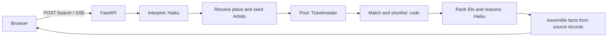

# Concert Scout

Concert Scout finds live music from a Taste, a place, or both, and turns up to eight Recommendations into a festival-style Poster. Open a name for its Ticket, then Save or Skip. Saved Concerts stay on this device; there is no general account system.

This is a non-commercial portfolio project by [Atherv Vidhate](https://atherv.com). The backend is Python/FastAPI; the frontend is Next.js 16, React 19 and Tailwind 4. Product terms are defined in [GLOSSARY.md](GLOSSARY.md).

## Run locally

Install Python 3.13+, [uv](https://docs.astral.sh/uv/), Node 24 and Redis (`brew install redis` on macOS).

```sh
cp api/.env.example api/.env
# Add TM_KEY, ANTHROPIC_API_KEY and GEOAPIFY_KEY privately. LASTFM_KEY is optional.
make dev
```

Open **http://127.0.0.1:3000**. The API runs without reload on port 8000 and uses real Redis, source APIs, limits and spend counters. `make start` builds and serves the production frontend instead. `make phone` does the same and prints an address for a phone on your network. Over plain HTTP, phones block location and Spotify refuses the sign-in redirect, so test those on an HTTPS deployment. For `make dev` through an HTTPS tunnel such as Tailscale Serve, set `DEV_ORIGINS` to the tunnel host, because Next blocks dev scripts requested from any other host. Keys stay on the API server and out of git.

Try `Tame Impala in London next summer`, `Dreamy bands in SoCal next month`, or a city on its own. The empty input rotates through examples. The location button asks for browser location only when pressed, and later Searches with no place look near it. Open an Artist from a Ticket for their Spotify link, top songs and similar Artists. Import Last.fm/ListenBrainz Taste or a local history file/list through Your Taste.

Spotify connection is optional and invite-only. It has its own deterministic shelf and never supplies model input. [Setup and pending live acceptance](docs/development/spotify.md).

## How a Search becomes a Poster



The interpreter extracts named Artists, style tags, a place and optional dates. Code expands common aliases, geocodes the place, resolves Artist identities and gathers a cached Concert pool. Matching combines seeds, similarity hops, tags and genre signals, then keeps up to 60 candidates. A second model call returns IDs, scores and short reasons. Assembly rejects unknown IDs and fills every Concert fact from the source record.

There are two model steps; some Searches need no ranking call. Place-only Searches use a source-linked Artist identity as a notability proxy and order Concerts by date. A ranker failure falls back to strong deterministic matches. Neither path pads a Poster with weak filler. Reasons remain judgments, and recommendation quality still needs human evaluation.

Dates, venues, times, prices and Ticket links do not come from the model. Missing facts stay absent. Candidate text is untrusted data and neither agent has tools. Spotify account metadata takes a completely separate route: encrypted OAuth session → exact-name lookups → an attributed shelf, with no pipeline/model dependency.

## Design choices

- **Separate Python service.** FastAPI owns source calls, secrets, SSE and enforcement; Next.js renders the interface. This keeps the agent work visible and testable in Python. [ADR 0001](docs/adr/0001-separate-python-agent-service.md).
- **Source facts, small model outputs.** Ranking returns IDs and reasons rather than re-emitting Concert records, protecting links and keeping requests smaller. [ADR 0002](docs/adr/0002-facts-never-pass-through-the-llm.md).
- **Shared Redis.** Public Concert chunks cache for six hours, Artist data for seven days and place lookups for thirty days. Rate and recorded-spend guards share the same store. New Searches stop at the recorded $1 daily or $10 monthly model-spend cap.
- **Streaming with honest presentation.** Status comes from real work. The name reveal waits for qualified picks, so an empty Search never flashes a misleading wall of Artists. Sparse Posters use less space. Typography and motion follow the [interface spec](docs/specs/04-interface.md); reduced motion skips the fly-in.
- **Local choices.** Saved Concerts and imported Taste use browser storage. History files are parsed locally; only Artist names leave the browser. Spotify account data never reaches a model. [ADR 0003](docs/adr/0003-official-spotify-access-only.md).

The app checks exact allowed origins, bot-check tokens, input bounds, hashed per-client limits and recorded spend before a paid Search. Errors give a code and an action. Traces record numeric timing/usage, without Taste or exception contents. [Platform details](docs/specs/05-platform.md) and [privacy](frontend/app/privacy/page.tsx).

## Evaluation and tests

Recommendation quality is judged by a person. Twenty drafted Searches cover seeds, sparse genres, descriptions, large/small cities, no place, different date windows and an empty answer. They have not all been judged; there is no claimed quality score yet.

```sh
cd api
uv run python -m evals.capture    # capture one real Search in advance; costs money
uv run python -m evals.judge <id> --snapshot <snapshot-id>  # human labels, offline
uv run python -m evals.judge       # or capture and judge together; costs money
uv run python -m evals.run         # replay judged Snapshots; no network or model spend
uv run python -m evals.run --live-model  # opt in to new model calls for a changed prompt
```

Snapshots preserve actual source responses and model answers so a changing concert calendar does not erase the evidence. They are gitignored. Measures include bad picks, must-find recall, judged relevance, source-fact integrity, capture latency and measured cost. Targets and tuning procedure: [evaluation spec](docs/specs/06-evals.md). Human labels must never be fabricated.

```sh
make check       # lint, types and app/data contracts; no paid requests
make e2e         # production browser journeys at 1280px and 390px, isolated real Redis
make check-live  # explicitly call configured real providers; one paid interpreter call
make check-context  # local transcript adapters; no model request
```

Install the browser once with `cd frontend && npx playwright install chromium`. Browser tests use typed app-owned adapter fixtures rather than inventing vendor API JSON. Live checks validate real providers separately. Failure traces and screenshots are kept by CI. [Testing boundaries and commands](docs/development/testing.md).

## Where the code lives

- `api/concert_scout/pipeline.py`: the Search steps; `matching.py` is pure scoring and `assemble.py` preserves source facts.
- `api/concert_scout/sources/`: async adapters; `pool.py` shares public Concert chunks and direct Artist lookups.
- `api/concert_scout/spotify.py`: encrypted sessions and the isolated shelf; `limits.py`, `security.py`, `telemetry.py`: enforcement and numeric evidence.
- `api/evals/`: capture, human judging and Pydantic Evals replay.
- `frontend/components/`: Search, Poster, Ticket, Artist and Taste panels, Saved Concerts and Spotify shelf.
- `frontend/e2e/`: browser contracts through the production API and frontend.
- `docs/specs/` and `docs/adr/`: requirements and lasting decisions. `docs/validation/` records checks and their limits.

## Data credits and current limits

Concert facts and links come from [Ticketmaster](https://www.ticketmaster.com). Artist identities/tags come from [MusicBrainz](https://musicbrainz.org); similarity/tags from [ListenBrainz](https://listenbrainz.org), with [Last.fm / AudioScrobbler](https://www.last.fm) as a similarity fallback and optional Taste import. Places use [Geoapify](https://www.geoapify.com) and [OpenStreetMap contributors](https://www.openstreetmap.org/copyright). The optional account shelf uses [Spotify](https://open.spotify.com) with its logo and links. The site footer links every source; MusicBrainz's [data licenses](https://musicbrainz.org/doc/About/Data_License) apply to its metadata.

Ticketmaster coverage is not the whole live-music calendar. Sparse tags and missing Artist IDs can hide relevant Concerts, while broad electronic genres can still produce weak picks. The similarity Labs API needs its fallback. The dataset still needs owner judgments. Spotify's live OAuth acceptance and public hosting remain pending their respective setup steps. Physical-device drag acceptance also remains a human check. Local implementation and passing CI are not a claim that those steps are finished.

Agent session recovery: [single-agent continuity and host setup](docs/development/session-recovery.md).
