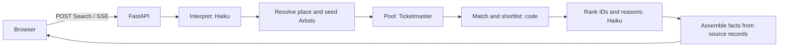

# Concert Scout

Find live music you would actually want to see. **[concertscout.app](https://concertscout.app)**

Describe what you like and where you can go, in your own words. "Tame Impala in London next summer" works, and so does "dreamy bands in SoCal next month" or a city on its own. Concert Scout reads the Search, works out which Concerts near you suit it, and sets up to eight of them as a festival Poster. Open a name for its Ticket, with the reason it was picked, the date, venue and a link to buy. Save it or skip it.

There are no accounts and no ads. Saved Concerts stay in your browser. Connect Spotify and your own Artists get a separate shelf of Concerts near you.

Built by [Atherv Vidhate](https://atherv.com) as a non-commercial portfolio project, with a Python agent service behind a Next.js frontend.

## How a Search becomes a Poster



1. The interpreter, a Claude Haiku call with no tools, turns the Search into named Artists, style tags, a place and dates.
2. Code geocodes the place and resolves each Artist through MusicBrainz.
3. Code gathers every Concert for that place and window from Ticketmaster, cached and shared between Searches.
4. Code scores those Concerts against the Taste, using similar Artists, tags and genres, and keeps up to 40.
5. The ranker, a second Haiku call, returns IDs, scores and a short reason. It sees short fields, never a date, price or link.
6. Code drops any ID it does not recognise and fills in every fact from the source record.

Each step streams to the browser as it happens, so the page shows real progress. A Search with only a place skips the ranker and lists Concerts by date. If the ranker fails, the Search falls back to the strongest matches from step 4 with a plain reason. Neither path pads a Poster with weak filler.

## Design decisions

The model never handles a fact. It returns IDs and reasons, so it cannot invent a date or change a Ticket link, and a missing time or price stays missing. [ADR 0002](docs/adr/0002-facts-never-pass-through-the-llm.md)

Python owns the agent. FastAPI holds the source calls, secrets, streaming and limits, and the browser talks to it directly. Next.js only draws the interface. [ADR 0001](docs/adr/0001-separate-python-agent-service.md)

Spotify data never reaches a model. A connected account takes its own route, from an encrypted session to exact-name lookups to an attributed shelf, and shares no code path with the agents. [ADR 0003](docs/adr/0003-official-spotify-access-only.md)

Candidate text is untrusted. A listing could contain anything, so neither agent has tools, and listings reach the ranker as quoted fields in a JSON object.

Dates follow the venue. A Concert's time reads on the venue's clock, and it is over when its date passes there. A visitor in another time zone also sees that zone's name.

Spend is capped in code. Before a paid Search, the API checks the exact origin, a bot token, input bounds, a limit of 10 Searches an hour per visitor, and recorded spend. New Searches stop at $1 a day or $10 a month in model cost. Visitor addresses are hashed before Redis sees them.

## Quality

A person judges recommendation quality, because nothing else can. Twenty drafted Searches cover named Artists, sparse genres, plain descriptions, big and small cities, and different date windows. Each is captured with its real source responses and model answers, so it can be replayed offline after the concert calendar has moved on.

The labels are not finished, so this project claims no quality score yet. The measures are bad picks, must-find recall, judged relevance, source-fact integrity, latency and cost. Runs can also be compared Artist by Artist. The [evaluation spec](docs/specs/06-evals.md) has the targets, and [the latest stability report](docs/validation/2026-11-07-ranker-stability.md) shows how much Posters vary between runs today.

## Stack

| Layer | Tools |
|---|---|
| Agent service | Python 3.13, FastAPI, Pydantic AI, Pydantic Evals, OpenTelemetry |
| Model | Claude Haiku 5.5 |
| Frontend | Next.js 16, React 19, Tailwind 4, coss ui, Motion |
| Storage | Redis for the cache, limits, spend and encrypted Spotify sessions. The browser keeps Saved Concerts |
| Hosting | Vercel, with Upstash Redis and Cloudflare Turnstile |

Contract tests run on every change, along with browser journeys at desktop and phone widths through the real API. [Testing notes](docs/development/testing.md).

## Where the code lives

```
api/concert_scout/
  pipeline.py     the Search steps
  matching.py     pure scoring
  assemble.py     builds Recommendations from source facts
  pool.py         shared Concert chunks and Artist lookups
  sources/        async adapters for each data source
  spotify.py      encrypted sessions and the separate shelf
  limits.py       visitor limits and spend caps
api/evals/        capture, human judging, replay and run comparison
frontend/
  components/     Search, Poster, Ticket, panels and shelf
  e2e/            browser journeys
docs/
  specs/          what the product does
  adr/            lasting decisions
  validation/     what was checked, and what that does not prove
```

## Limits

Ticketmaster does not list every show, so small rooms can be missing. Sparse tags and missing Artist IDs can hide a good Concert, and broad electronic genres can still produce weak picks. Reasons are the model's own words about an Artist, so they can be wrong. Dates, venues and links come straight from the source.

Spotify is invite-only for now, because of how Spotify limits new apps.

## Data credits

Concert facts and links come from [Ticketmaster](https://www.ticketmaster.com). Artist identities and tags come from [MusicBrainz](https://musicbrainz.org), under its [data licenses](https://musicbrainz.org/doc/About/Data_License). Similarity and tags come from [ListenBrainz](https://listenbrainz.org), with [Last.fm](https://www.last.fm) as a fallback and an optional Taste import. Places use [Geoapify](https://www.geoapify.com) and [OpenStreetMap contributors](https://www.openstreetmap.org/copyright). The account shelf uses [Spotify](https://open.spotify.com).
